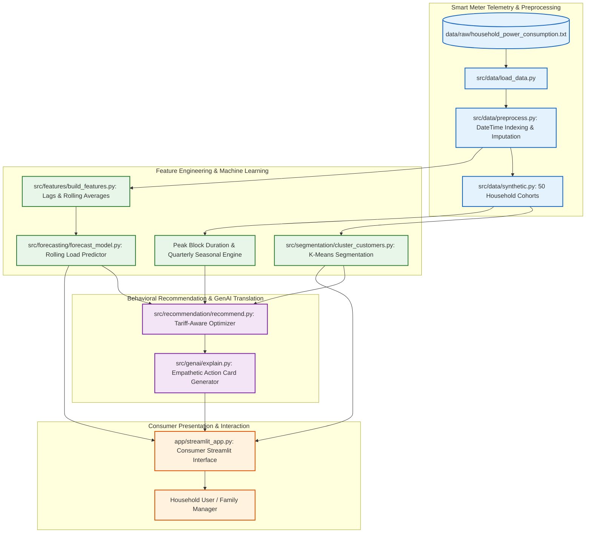

# Product Requirements Document (PRD): WattsUp-AI-Energy-Coach (Household Energy Intelligence & Behavioral Coach)

**Product Lead:** Uday Kiran  
**Status:** MVP Operational / Household Energy Intelligence & Behavioral Coach  
**Category:** ClimateTech, Consumer IoT, and Smart Utility Analytics  
**Primary Repository:** `Own Ideas/wattsup-ai-energy-coach`  

---

## 1. Executive Summary

### 1.1 Context & Background
Household energy bills are soaring, and climate-conscious consumers are increasingly eager to lower their environmental footprints and utility costs. Yet, modern utility interfaces remain completely unhelpful. Consumers receive a single aggregated kilowatt-hour (kWh) electricity bill 30 days after consumption occurred. By the time the bill arrives, the money is already spent, creating a complete disconnect between daily habits and financial impact.

Meanwhile, utility portals and smart meter dashboards suffer from the "Data Rich, Insight Poor" paradox. They present consumers with complex electrical engineering charts: active power, reactive power, voltage phase variations, and raw minute-by-minute time-series curves. An ordinary homeowner or apartment tenant does not think in "kilovolt-amperes reactive"; they think: *"Why was my bill ₹3,000 higher this month, and what should I change tomorrow to stop it?"*

### 1.2 The Product Solution
To transform opaque energy data into empathetic consumer agency, I conceptualized and engineered **WattsUp-AI-Energy-Coach**. WattsUp is an end-to-end household energy forecasting, behavioral segmentation, and AI coaching platform. 

Operating on high-frequency smart meter telemetry (`household_power_consumption.txt`), WattsUp:
1.  **Deconstructs Multi-Zone Consumption:** Breaks down global active power into tangible functional zones: Sub-meter 1 (Kitchen appliances), Sub-meter 2 (Laundry/dryer), and Sub-meter 3 (Water heating and climate control).
2.  **Forecasts Next-Day Load (`src/forecasting/`):** Utilizes temporal lag variables and rolling 7-day baselines to forecast next-day household energy demand curves.
3.  **Clusters Consumer Personas (`src/segmentation/`):** Identifies behavioral usage archetypes (e.g., peak-hour heavy, vampire phantom draw, diurnal regularity) using unsupervised clustering.
4.  **Delivers GenAI Action Cards (`src/genai/`):** Translates complex load forecasts into plain-English, actionable behavioral recommendations via an interactive Streamlit application (`app/streamlit_app.py`), enabling households to shift discretionary loads to off-peak hours and save money without sacrificing domestic comfort.

---

## 2. Product Vision & North Star
*   **Vision:** "Transforming Opaque Energy Bills into Actionable, Empathetic Energy Agency." We believe households do not need confusing electricity charts; they need clear, predictive guidance on when and how to shift energy use to save money and reduce emissions.
*   **Core Value Proposition:** Bridging the gap between raw smart meter telemetry and domestic decision-making through predictive load forecasting and empathetic, plain-language coaching.
*   **North Star Metric:** *Actionable Energy Shifting Rate (AESR)*: The percentage of household peak-load kilowatt-hours successfully shifted to off-peak or solar-abundant hours following coach recommendations (Target: > 25%).

---

## 3. Problem Statement & User Personas

### 3.1 Problem Dimensions
1.  **The Post-Mortem Utility Bill:** Consumers only see energy costs weeks after consumption occurred, eliminating any opportunity for real-time behavioral adjustments.
2.  **The Data Rich, Insight Poor Paradox:** Smart meters record minute-by-minute telemetry, but utility portals dump raw line charts on consumers without explaining *which appliance* or *which habit* caused the spike.
3.  **Generic Conservation Fatigue:** Traditional utility advice ("turn off lights") is patronizing and ignores the real drivers of domestic power surges (HVAC cycles, laundry heating elements, water heaters).
4.  **The Phantom Load Trap:** Standby power ("vampire draw") from idle entertainment systems, chargers, and appliances accounts for up to 20% of domestic power bills without the homeowner realizing it.

### 3.2 Target Personas
*   **Persona A: The Budget-Conscious Family Manager:** Seeks to reduce monthly utility expenditures and eliminate surprise bill spikes without compromising daily domestic routines.
*   **Persona B: The Eco-Conscious Suburban Homeowner:** Has rooftop solar or time-of-use (ToU) tariffs and wants predictive guidance on when to run high-load appliances (washing machines, dishwashers) to maximize clean energy utilization.
*   **Persona C: The Smart Home Enthusiast:** Enjoys tracking home energy efficiency and wants plain-language explanations of phantom loads and seasonal consumption shifts.

---

## 4. Goals & Non-Goals

### Goals
*   **High-Frequency Telemetry Ingestion:** Clean and preprocess multi-year minute-level power consumption datasets, handling active power, reactive power, voltage, global intensity, and sub-metering zones.
*   **Rolling Load Forecasting:** Train and evaluate rolling 24-hour demand forecasting models incorporating lag features (`lag_1`, `lag_2`, `lag_7`) and 7-day rolling means.
*   **Unsupervised Household Segmentation:** Cluster household profiles based on consumption volume, peak-to-average ratios, and duration of peak usage blocks.
*   **Peak Duration & Seasonal Intelligence:** Implement downsampled peak-block duration tracking and quarterly seasonal consumption breakdowns.
*   **Empathetic GenAI Coaching Cards:** Generate plain-English recommendations translating kilowatt-hour deltas into financial savings and peak-grid avoidance advice.
*   **Interactive Streamlit Dashboard:** Provide an accessible, role-based consumer UI for exploring forecasts, sub-metering distributions, and daily recommendations.

### Non-Goals
*   Direct hardware IoT smart-plug switching or automated appliance control in v1. The focus is strictly on consumer behavioral coaching, preserving user autonomy and avoiding hardware liability.
*   Industrial-scale grid dispatch modeling (WattsUp is engineered specifically for residential household telemetry).

---

## 5. User Journeys & Operational Workflows

### 5.1 Weekly Household Energy Review Workflow
1.  **Dashboard Access:** User opens the local Streamlit application (`streamlit run app/streamlit_app.py`).
2.  **Household Profile Selection:** User selects their household profile from simulated cohorts.
3.  **Forecast Review:** The app displays tomorrow's projected load curve, highlighting expected peak hours (e.g., 6:00 PM to 9:00 PM).
4.  **Action Card Delivery:** The GenAI coaching layer presents an action card: *"Tomorrow is projected to have heavy evening demand. Running your dishwasher at 10:00 PM instead of 7:30 PM will save ₹45 under your time-of-use tariff and reduce grid strain."*
5.  **Behavioral Confirmation:** The user acknowledges the action, shifting their appliance schedule.

### 5.2 Quarterly Seasonal & Vampire Load Audit
1.  **Audit Navigation:** User navigates to the "Seasonal & Peak Analysis" tab.
2.  **Quarterly Comparison:** The system shows quarterly consumption trends (Q1 through Q4), identifying seasonal heating or cooling spikes.
3.  **Phantom Load Detection:** SANE/WattsUp algorithms analyze the overnight baseline (1:00 AM to 5:00 AM), calculating continuous vampire draw and suggesting power-strip shutdowns.

---

## 6. End-to-End System Architecture



---

## 7. Functional Requirements

### Module 1: Data Ingestion & Household Cohort Simulation (DIHC)
*   **FR-DIHC-01 (High-Frequency Preprocessing):** `load_uci_data` and `preprocess_data` must parse minute-by-minute text datasets, format UTC timestamps, handle missing values via linear interpolation, and enforce clean datetime indexes.
*   **FR-DIHC-02 (Multi-Household Synthetic Simulation):** `generate_synthetic_households` must generate realistic synthetic cohorts (default: 50 households) with varying base loads, peak distributions, and appliance profiles to test segmentation algorithms.
*   **FR-DIHC-03 (Sub-Metering Isolation):** The ingestion pipeline must isolate Sub-metering 1 (Kitchen), Sub-metering 2 (Laundry room), and Sub-metering 3 (Electric water-heater and air-conditioner).

### Module 2: Feature Engineering & Load Forecasting (FELF)
*   **FR-FELF-04 (Temporal Lag Extraction):** `add_lag_features` must calculate autoregressive lag features (`lag_1`, `lag_2`, `lag_7`), 7-day rolling means (`rolling_7d_mean`), and calendar day-of-week variables.
*   **FR-FELF-05 (Rolling 24-Hour Load Predictor):** `train_forecast_model` must train predictive models over historical splits (80% train, 20% test) to forecast next-day `Global_active_power` curves.
*   **FR-FELF-06 (Forecast Metric Evaluation):** `evaluate_model` must compute regression evaluation metrics (RMSE, MAE, R-squared) to validate load prediction boundaries.

### Module 3: Behavioral Segmentation & Peak Analytics (BSPA)
*   **FR-BSPA-07 (K-Means Household Clustering):** `cluster_households` must cluster consumer profiles using aggregated consumption features (`mean`, `max`, `std`), assigning households to distinct behavioral cohorts.
*   **FR-BSPA-08 (Seasonal Quarterly Aggregation):** The analytics engine must group household records into calendar quarters (Q1 through Q4), reporting quarterly average daily kWh usage to identify seasonal drift.
*   **FR-BSPA-09 (Peak Block Duration Analysis):** The engine must detect peak events using the 80th consumption percentile, compute consecutive peak blocks, and calculate the distribution of peak durations.

### Module 4: Behavioral Recommendations & GenAI Coaching (BRGC)
*   **FR-BRGC-10 (Tariff-Aware Recommendation Engine):** `get_recommendations` must generate rule-based suggestions mapped to cluster archetypes, suggesting specific appliance shifting schedules.
*   **FR-BRGC-11 (Empathetic GenAI Translation):** `generate_customer_explanation` must translate technical metrics and recommendations into plain-English conversational action cards that emphasize financial savings and avoid shaming language.
*   **FR-BRGC-12 (Interactive Streamlit Interface):** `app/streamlit_app.py` must render load forecasts, sub-metering breakdowns, cluster summaries, and personalized recommendation cards interactively.

---

## 8. Non-Functional Requirements (NFRs)

### Performance & Latency
*   **Dashboard Load Latency:** Streamlit dashboards must load precomputed household profiles and render interactive charts in under 2 seconds.
*   **Forecast Inference Latency:** Generating a 24-hour demand prediction must execute in under 350 milliseconds.

### Model Accuracy & Interpretability
*   **Forecast Error Boundaries:** Mean Absolute Percentage Error (MAPE) must remain below 12% across standard residential load cycles.
*   **Explainability:** Every generated recommendation must cite the underlying data trigger (e.g., peak-hour tariff surge or high vampire baseline).

### Safety & User Autonomy
*   **Zero Forced Automation:** The platform must never trigger hardware relays or cut power automatically; user autonomy is strictly preserved.

---

## 9. Data Model & Storage Specifications

### 9.1 Raw Smart Meter Telemetry Schema
| Column Name | Type | Unit | Description |
| :--- | :--- | :--- | :--- |
| `Date` | String | DD/MM/YYYY | Calendar date of observation |
| `Time` | String | HH:MM:SS | Time of observation |
| `Global_active_power` | Float | Kilowatts (kW) | Total household active power |
| `Global_reactive_power` | Float | Kilowatts (kW) | Total household reactive power |
| `Voltage` | Float | Volts (V) | Minute-averaged voltage |
| `Global_intensity` | Float | Amperes (A) | Minute-averaged current intensity |
| `Sub_metering_1` | Float | Watt-hours | Kitchen (dishwasher, microwave) |
| `Sub_metering_2` | Float | Watt-hours | Laundry room (washing machine, tumble dryer) |
| `Sub_metering_3` | Float | Watt-hours | Climate control (electric water heater, AC) |

### 9.2 Action Card JSON Schema
```json
{
  "household_id": 14,
  "cluster_profile": "Evening Peak Heavy",
  "projected_peak_window": "18:00 - 21:00",
  "target_appliance": "Dishwasher / Laundry",
  "recommended_shift_time": "22:00",
  "estimated_daily_savings": "₹45.00",
  "coaching_message": "Tomorrow evening is projected to have heavy power demand. Running your laundry at 10 PM instead of 7 PM will take advantage of off-peak rates and save ~₹45."
}
```

---

## 10. The Strategic Scope Decision: Autonomous IoT Switching vs Behavioral Coaching

During early product roadmapping, the engineering instinct was to build direct IoT hardware integrations (e.g., smart plugs with MQTT relays) to automatically kill power to appliances during peak tariff windows.

### Why Autonomous Switching Was Scoped Out
As a Product Manager, understanding user psychology is vital:
1.  **The Loss of Control:** Users strongly reject software that turns off household appliances without consent (e.g., cutting power to an active washing machine or home office setup triggers intense anger).
2.  **Safety and Hardware Liability:** Automated switching of high-load appliances (water heaters, space heaters) introduces severe fire safety and equipment damage liabilities.
3.  **Behavioral Coaching Works Better:** True sustainability comes from helping families build natural energy awareness. By using GenAI to explain *why* and *when* to shift usage, WattsUp builds long-term habits while leaving users in complete control.

---

## 11. Competitive & Alternative Approaches

| Feature / Dimension | WattsUp-AI-Energy-Coach | Utility Smart Meter Portals | Commercial Home Energy Monitors (Sense, Emporia) | Generic Conservation Tips |
| :--- | :--- | :--- | :--- | :--- |
| **Data Presentation** | Predictive plain-English coaching action cards | Raw active power charts and post-mortem bills | Real-time appliance disaggregation dashboards | Static pamphlets ("Turn off lights") |
| **Forecasting** | Next-day 24-hour predictive load curve | None (historical only) | Basic historical extrapolations | None |
| **Behavioral Empathy** | High: positive nudges celebrating savings | Zero: cold engineering charts | Low: dense telemetry graphs | Low: patronizing and vague |
| **Hardware Requirement** | Zero (operates on standard smart meter telemetry) | Smart meter | Dedicated hardware CT clamps ($200 to $350) | None |
| **Cost** | Free and open source | Included in utility bill | Upfront hardware + potential subscription | Free |

---

## 12. Edge Cases & Operational Resiliency

### 12.1 Missing Smart Meter Data Imputation
*   *Symptom:* Telemetry drops or sensor disconnections produce null entries in active power.
*   *Mitigation:* Preprocessing pipelines apply forward-fill and rolling linear interpolation to maintain continuous time-series alignment without distorting peak statistics.

### 12.2 Sudden Weather Shifts Disrupting Forecasts
*   *Symptom:* Unseasonal temperature drops cause unexpected electric heating surges.
*   *Mitigation:* Rolling 7-day average features allow the model to adapt to multi-day weather shifts while flagging rapid deviations in the UI.

---

## 13. Metrics & Key Performance Indicators

### Product & Impact KPIs
*   **Actionable Energy Shifting Rate (AESR):** Target > 25% of flexible kilowatt-hours shifted to off-peak hours.
*   **Forecast Accuracy (MAPE):** Maintained < 12% across residential testing cohorts.
*   **Phantom Load Reduction:** Average reduction of > 15% in passive overnight idle power consumption.
*   **User Engagement:** > 35% of recommendations reviewed and acknowledged in the Streamlit interface.

---

## 14. Risk Assessment & Mitigations

| Identified Risk | Likelihood | Impact | Strategic Mitigation |
| :--- | :--- | :--- | :--- |
| **Algorithm Fatigue** | Medium | Medium | Limit coaching alerts to high-impact opportunities (maximum 1 or 2 actionable tips daily). |
| **Tariff Schedule Complexity** | Medium | High | Maintain flexible tariff configuration modules supporting flat, tiered, and time-of-use pricing models. |
| **User Privacy** | Low | High | All household telemetry and models run locally; zero domestic activity data shared with external vendors. |

---

## 15. Technical Stack & Implementation Details
*   **Runtime Language:** Python 3.10+
*   **Data Processing & Machine Learning:** Pandas, NumPy, Scikit-learn (K-Means, Linear Regression, Random Forest)
*   **Visualization & Dashboard:** Streamlit, Matplotlib, Seaborn
*   **Explainability & NLP:** Custom template-based and generative explanation modules (`src/genai/`)
*   **Configuration & Architecture:** Modular structure separating `src/data`, `src/features`, `src/forecasting`, `src/segmentation`, and `src/recommendation`.

---

## 16. Release Criteria & Verification Gates
1.  **Data Ingestion Gate:** `main.py` processes raw UCI datasets, imputes missing values, and builds temporal features without runtime errors.
2.  **Forecast Accuracy Gate:** Model achieves R-squared > 0.70 on holdout test datasets.
3.  **Clustering Stability Gate:** K-Means cleanly divides 50 synthetic households into distinct behavioral archetypes with non-overlapping centroid profiles.
4.  **UI Interactivity Gate:** `streamlit run app/streamlit_app.py` boots cleanly and displays all forecasts, quarterly breakdowns, and recommendation cards.

---

## 17. Product Roadmap & Evolution

### Phase 1: Core Forecasting & Analytics (Completed)
*   Delivered multi-zone data preprocessing and synthetic household generation.
*   Delivered rolling lag feature engineering and demand forecasting models.
*   Delivered K-Means behavioral clustering and peak duration tracking.
*   Delivered initial Streamlit interface and GenAI action cards.

### Phase 2: Dynamic Tariff & Solar Optimization (Current)
*   Integration of dynamic hourly wholesale pricing and solar feed-in tariff schedules.
*   Automated detection of solar self-consumption windows for rooftop solar owners.

### Phase 3: Connected Home Integrations (Future)
*   Voluntary opt-in smart thermostat setpoint recommendations (e.g., pre-cooling homes by 1°C during solar hours).
*   Community micro-grid sharing insights.

---

## 18. Operator Guide (Running WattsUp)

### 18.1 Setup & Installation
```bash
python -m venv .venv
.\.venv\Scripts\activate
pip install -r requirements.txt
```

### 18.2 Executing the Analytics Pipeline
```bash
python main.py
# Runs end-to-end data load, forecasting evaluation, clustering, and customer reports.
```

### 18.3 Launching the Streamlit App
```bash
streamlit run app/streamlit_app.py
```

---

## 19. PM Strategic Retrospective
WattsUp-AI-Energy-Coach demonstrates that in ClimateTech and data science, **model accuracy is secondary to human actionability**. Spending weeks tuning complex neural networks to reduce error by 1% creates zero user value if the output remains an indecipherable time-series line chart. By focusing on the human decision boundary: translating electrical metrics into plain-English schedule shifts and financial savings: WattsUp turns passive bill anxiety into proactive domestic empowerment.

---

## 20. Conclusion
WattsUp bridges the critical divide between smart meter telemetry and consumer behavior. By pairing predictive load forecasting with empathetic AI coaching, WattsUp empowers everyday families to take control of their energy bills, support grid stability, and participate meaningfully in the clean energy transition.
